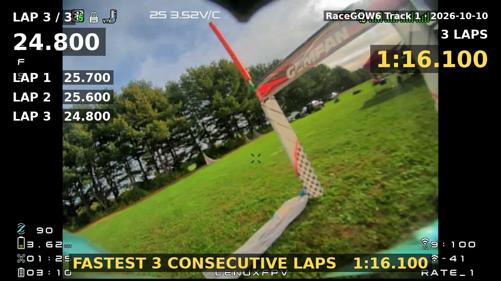

# FPV DVR Lap Timer

**Download (Windows):** [FPVDVRLapTimer-Setup.exe](https://github.com/lenuxfpv/fpv-dvr-lap-timer/releases/latest/download/FPVDVRLapTimer-Setup.exe)
(installer) · [FPVDVRLapTimer.exe](https://github.com/lenuxfpv/fpv-dvr-lap-timer/releases/latest/download/FPVDVRLapTimer.exe)
(portable) · [all releases](https://github.com/lenuxfpv/fpv-dvr-lap-timer/releases). Linux: see [Install](#install).


**Why I made it:** I was looking for an easy way to review my DVR files to find my laps for competing in
RaceGOW. The app never modifies the DVR video files, and it can export a video of my fastest laps that I can
submit as my RaceGOW entry.

**Quick start:** install, add a video, press **Z** on each pass through the start/finish gate, then export your
fastest laps. See *Workflow* for the steps, and [How to export your fastest laps](docs/EXPORT.md) for every
export option.

## What it is

FPV DVR Lap Timer turns the footage your goggles record into lap times. Open a flight, step to the exact frame
where you cross the start/finish gate and press one key; every mark after the first ends a lap and starts the
next. There is no timing hardware and no transponder: the video is the stopwatch, and because each mark is
placed on a frame you can see, the times are accurate to the frame and easy to double-check.

## What it can do

- **Mark laps frame by frame.** Play, shuttle (0.1x to 16x), step single frames or jump between gates, then mark
  the frame on screen. Marks can be moved (even a single frame with a key) or deleted, any lap can be flagged as
  bad with one key, and Ctrl+Z undoes your mark changes. A label and a timer on the video show which lap you are in.
- **Scrub smoothly.** It builds a small all-keyframe copy of each video in the background, so scrubbing and
  frame-stepping are fluid even on `.ts` DVR files.
- **Keep a library.** Videos are grouped by track and session date, and each card shows the lap count, fastest lap
  and fastest run at a glance. Add a note to a video (battery, props, tune) and search by name, track or note. Move
  or rename files and the marks stay attached.
- **Add new flights without the chore.** Point the app at your DVR folder (subfolders are fine) and it offers the
  new videos each time it starts, with the track suggested from the folder name.
- **Find your best.** Fastest lap and your fastest run of consecutive laps (3 by default, 2-10 per track), per
  video and across a whole track, with a lap chart and a progress chart to see improvement over time, plus how
  consistent your laps are. In the open video the fastest lap is highlighted in gold and the fastest run in blue,
  in the gate list and on the seek bar.
- **Compare two laps.** Play any two laps side by side, even from different videos on the same track, both starting
  on their gate frame, to see where one gains on the other.
- **Export a shareable video.** Cut your fastest run from the original footage with a lap timer drawn on it,
  optional start and end pictures (your pilot handle, say), your own intro and outro videos, your own audio or
  none, and padding either side. You can also export any laps you choose, and move or hide parts of the timer.
  [Export guide](docs/EXPORT.md).
- **Export your data.** Lap times to CSV, and the whole library to a single file you can back up, move to another
  computer or merge into another library.
- **Fit a small screen.** A compact layout and a hideable library panel bring the window down to about 780-1040 px
  wide.

It runs on Windows (installer or portable exe) and Linux, and reads `.ts`, `.mp4`, `.mov`, `.mkv`, `.m4v` and
`.avi` files. Found a bug or have an idea? [Open an issue](https://github.com/lenuxfpv/fpv-dvr-lap-timer/issues).

## Install

| You use | Easiest route |
|---|---|
| Windows | Download **`FPVDVRLapTimer-Setup.exe`** from the [Releases page](https://github.com/lenuxfpv/fpv-dvr-lap-timer/releases). No Python needed. |
| macOS (**untested**) | Download **`FPVDVRLapTimer-macOS.dmg`** from the [Releases page](https://github.com/lenuxfpv/fpv-dvr-lap-timer/releases), open it and drag the app to Applications. See *macOS* below. |
| Linux | Run `./install.sh` from the project folder (needs Python 3.9+). |
| Either, from source | `python3 lap_timer.py` with Python 3.9+ and PyQt6 installed. |

The one thing worth adding yourself is **ffmpeg**; see *What it needs* just below.

### What it needs

- **Python 3.9+ and PyQt6**, only when running from source. The Windows installer and exe bundle both.
- **ffmpeg** (strongly recommended). It provides two programs, and the app works without them, just less smoothly:
  - `ffprobe` reads each video's frame rate. Without it the app assumes 30 fps, and frame-stepping is off for other
    frame rates.
  - `ffmpeg` builds the smooth-scrub copies. Without it scrubbing only jumps between keyframes (see *Navigating the
    video*).
- **The libx264 encoder** inside your ffmpeg, used for the smooth copies and the video export. Debian/Ubuntu's
  `ffmpeg` and the Windows `winget install Gyan.FFmpeg` build include it. Fedora's default `ffmpeg-free` does not:
  enable RPM Fusion and run `sudo dnf swap ffmpeg-free ffmpeg --allowerasing`.
- **A bold font file** for the video export's timer, normally already installed (DejaVu Sans or Liberation on Linux,
  Arial on Windows, Arial or Helvetica on macOS).

The install scripts check all of this and tell you how to fix anything missing.

### Run from source

```
python3 lap_timer.py                          # open the app
python3 lap_timer.py flight1.ts flight2.mp4   # open and add these videos to the library
```

You can also drag video files or folders onto the window.

### Windows

**Installer (easiest).** Run **`FPVDVRLapTimer-Setup.exe`** (download it from the link at the top). It needs no Python
and no admin rights.

- It installs to `%LOCALAPPDATA%\Programs\FPV DVR Lap Timer`, adds a Start Menu shortcut (and a Desktop one if you
  tick it) and an "FPV DVR Lap Timer" entry in Settings > Apps, where you can uninstall it.
- The uninstaller asks whether to also delete the smooth-scrub copies; your library and videos are never touched.
- The release also has the bare `FPVDVRLapTimer.exe` if you prefer a portable copy (it has no Apps entry).

**"Windows protected your PC" (SmartScreen).** The installer and exe aren't code-signed (a signing certificate costs
money every year), so Windows SmartScreen may show a blue warning the first time you run them. It appears for any
new, unsigned program and doesn't mean anything is wrong with the file. Click **More info**, then **Run anyway**.
If your browser blocks the download, choose **Keep** from its download menu. The source is all in this repository
if you want to check what you are running.

**ffmpeg.** It isn't bundled. If ffmpeg or ffprobe can't be found when the app starts, it offers to install ffmpeg with
winget (tick *Don't ask again* to stop the prompt, and use **Help → Install ffmpeg…** any time). The app picks up a
freshly installed ffmpeg without a restart. You can also install it yourself (`winget install Gyan.FFmpeg`) or put
`ffmpeg.exe` and `ffprobe.exe` in a `bin` folder next to the app.

**From source with `install.bat`.** Double-click **`install.bat`** (or run `install.bat -Desktop` for a Desktop
shortcut too). It creates a private `.venv`, installs PyQt6, and adds a Start Menu shortcut and an "FPV DVR Lap Timer"
entry in Settings > Apps that runs the uninstall. It needs Python 3.9+; if Python or ffmpeg is missing it offers to
install them with winget (or run `winget install Python.Python.3.12` yourself), and it warns if your ffmpeg lacks
libx264. If a script fails, the error message says which step; the app itself needs only `pip install PyQt6`.

- `install.bat -Uninstall` removes the shortcuts and leaves your library alone. It asks whether to also delete the
  cached smooth copies to free disk space.
- `install.bat -Uninstall -ClearCache` deletes them without asking.

**Building it yourself.** See [docs/BUILDING.md](docs/BUILDING.md).

### macOS

**The macOS version is untested.** It is built automatically but nobody has run it on a Mac yet, so expect rough edges
and please report problems. Open the `.dmg` and drag **FPV DVR Lap Timer** into Applications. It is built for Apple
Silicon (M1 and later).

**"Can't be opened because the developer can't be verified".** The app isn't signed with an Apple Developer
certificate (that costs money every year), so Gatekeeper blocks the first launch. Right-click the app, choose
**Open**, then **Open** again. You only need to do this once. If macOS still refuses, run
`xattr -dr com.apple.quarantine "/Applications/FPV DVR Lap Timer.app"` in Terminal.

**ffmpeg.** It isn't bundled. If it can't be found when the app starts, the app offers to run `brew install ffmpeg`
for you (**Help → Install ffmpeg…** any time; without [Homebrew](https://brew.sh) it points you to the Homebrew site
first). You can also run that command yourself. The app looks in
`/opt/homebrew/bin` and `/usr/local/bin`, so it finds it even when opened from Finder. Homebrew's ffmpeg includes
libx264. Your library is stored in `~/Library/Application Support/fpv-dvr-lap-timer/`.

Intel Macs: run from source (`python3 lap_timer.py`, with PyQt6 installed).

### Linux

```
./install.sh               # menu launcher; uses system PyQt6, or creates a private .venv
./install.sh --desktop     # also a Desktop shortcut
./install.sh --uninstall   # remove launcher + icon (library and videos untouched); asks about the smooth copies
./install.sh --uninstall --clear-cache   # ...and delete the smooth copies without asking
```

The script adds an application-menu launcher that points at the folder you run it from, so keep the project folder
where it is after installing (if you move it, run the script again). If anything from *What it needs* is missing, it
warns you and prints the fix for your distro. Uninstalling leaves your library alone and asks whether to also delete
the cached smooth copies to free disk space.

## Where your data lives

Everything is stored in one SQLite database, `library.db`: Linux `~/.local/share/fpv-dvr-lap-timer/`, Windows
`%APPDATA%\fpv-dvr-lap-timer\`, macOS `~/Library/Application Support/fpv-dvr-lap-timer/`. Set the environment variable `FPV_LAP_TIMER_DB` to use a different file. It holds
each video's path, gate marks, bad-lap flags, track name, session date and notes, plus the track you gave each
folder's videos and the DVR check's list of files it has already offered. Back up that one file to keep your
history.

- **Smooth-scrub copies** live in a cache folder, never next to your videos: Linux `~/.cache/fpv-dvr-lap-timer/smooth`,
  Windows `%LOCALAPPDATA%\fpv-dvr-lap-timer\smooth`, macOS `~/Library/Caches/fpv-dvr-lap-timer/smooth`.
- **Preferences** (theme, keyboard shortcuts, compact layout, the DVR folder, the *Auto-build* / *Build when adding*
  checkboxes, your export options) are stored
  separately by Qt (Linux `~/.config/fpv-dvr-lap-timer/app.conf`, Windows registry, macOS a preferences file in `~/Library/Preferences`) and are not part of the library
  file.
- **Help → About** shows the library folder and the smooth-copies folder as links that open them in your file
  manager.
- **Nothing is written next to your videos** (apart from an exported video, which you choose to save), and the app
  never modifies or deletes video files.

**Duplicate protection.** Adding a file that is already in the library (the same file reached through a
different path, a symlink, or a copy with the same name, size and date) is refused with a warning
listing what was skipped, because the same laps would otherwise be counted twice in your stats. If
duplicates are already in the library they show as **⚠ duplicate** (orange) in the list, and the
Library stats window shows a warning for the track/view that contains them. Remove the extra entry
with *Remove videos…*; the video file is not touched.

If a video is moved or renamed it shows in red; double-click it and pick the new location. Your
marks stay attached.

### Backing up, moving and merging the library

The **Library** menu works on the whole database, so you don't have to find `library.db` yourself:

- **Export library…** saves a copy to a `.db` file you choose (named with today's date by default).
- **Import library (replace)…** swaps your library for an exported file. Your current library is saved
  first as `library-before-import-<date-time>.db` next to `library.db`.
- **Merge library…** adds another library to yours without overwriting anything. Videos are matched by
  file path: new videos come across with their marks, track, session date and notes; for videos you both have,
  marks at times you don't already have are added and an empty track, session date or note is filled in
  (your own marks and settings are kept). A summary shows what was added.

To move to another computer, export on the old one and import (or merge) on the new one. You can also copy
`library.db` to the new machine's location above.

Video paths are stored as full paths, so they show in red if the videos live somewhere else on the new machine.
Click **Fix paths…** in the library panel:

- It lists every folder that has missing videos, one row each. Pick the new folder for each (they can be different
  places, and a blank row is skipped) and the videos are re-pointed at once.
- It converts between Windows (`D:\Drone`) and Linux (`/mnt/Drone`) style paths.
- It shows how many of the new locations actually exist before you apply it.

## The video library list

Each video in the left panel is shown as a card:

```
RaceGOW6 Track 1                  ⚡
LAPS      FASTEST     FASTEST 3
6/7       0:25.737    1:22.591
20261010-155234.ts       2026-10-10
```

- **Track name** in large bold type (*No track* in grey italics if none is set).
- **LAPS** = good / total laps marked, **FASTEST** = best good lap, **FASTEST 3** = best three good laps in a
  row (a dash until there are three in a row; the 3 follows your *Fastest run* setting for the track, see *Reports*).
  Bad laps are excluded, as everywhere else.
- The **file name** is on a small line at the bottom (shortened in the middle if long), with the session
  date at its right.
- Badges at the top right: **📝** the video has a note, **🔒** auto-build is off for this video, **⚡** smooth-scrub copy ready, **⚠ duplicate**
  (orange) same file listed twice, **⚠ not found** (red) the file is missing - double-click it to locate it.
- Hover a card for its full path (and its note).
- Above the list: a **track** filter, a **Sort** box (date, fastest lap or fastest run), a **Show** box (all videos,
  not marked yet, or marked only) and a **search box** that matches file names, tracks and notes.
- The **Remove videos…** button (or *Remove from library* in the right-click menu) takes the selected videos out of the library, with their marks. The video file is not touched.

**Right-click menu.** Right-click a video (or a selection; right-clicking an unselected video acts on just that one):

- **Assign to track** lists your existing tracks (ticked if the selected videos are already on it) plus **New track…**.
- **Remove from track** clears the track.
- **Add note…** / **Edit note…** sets a note on the video(s) with one small box (empty clears it).
- **Track, date & notes…** (also **Track / date / notes…** under the list) opens the full dialog (see *Tracks and session dates*).
- **Delete smooth copy and lock** and **🔒 Don't auto-build smooth copy** manage the video's smooth copy (see
  *Deleting or locking a smooth copy*).

## Workflow

1. **Add videos** with *Add videos…*, *Add folder…* (scans subfolders), or drag and drop. A list of the files found
   is shown first: untick the ones you don't want (or use *Select none* / *Select all*) and pick a **track** for each
   file in the *Track* column. To set many at once, pick a track in the *Track* box under the list and press *Set track
   for ticked files*; *＋ New track…* creates one that doesn't exist yet. Then click *Add N videos*. Files already in
   the library are greyed out and not added again. Dropping loose files adds them straight away, to the track being
   viewed. When you add a folder, each video's track is **suggested from the name of the folder it sits in**
   (`RaceGOW/Track 1/flight.ts` starts on *Track 1*, or on the track you gave that folder's videos last time; a folder
   named like an existing track, in any capitals, uses that track; videos directly in the folder you picked get no
   suggestion). Change any of them in the list. Videos that this app exported are left out of folder scans. A *Note
   for all added videos* box saves one note on everything you add. Or skip all this: choose a **DVR folder** and the
   app offers new flights for you (see *DVR folder*).
2. Select videos and click **Track / date / notes…** to set a track name, session date and notes (see *Tracks and session dates*).
3. Double-click a video to open it.
4. Play or scrub to the moment you pass through the gate and press **Z** (or the green button; the key can be
   changed, see *Changing the keys*). The first mark starts lap 1; every later mark ends a lap and starts the next.
5. Review the table on the right and flag any bad laps.

### Navigating the video

**Smooth-scrub copy.** FPV recordings (especially `.ts`) have a keyframe only every second or two, and a player can
only show those frames when you jump around, so scrubbing looks stuck and single-frame stepping doesn't work. The app
fixes this by building a small 480p copy of each video in which every frame is a keyframe (ffmpeg; builds at roughly
5x real time). Each copy is about 15-20% of the original's size (a 2.5 minute video is ~100-130 MB). It is built in
the background, after which the app switches to it automatically and keeps your position. Opening a video while its
copy is still building works fine. When copies get built:

- **When you add videos** (checkbox *Build when adding videos* in the library panel, on by default):
  every new video is queued and built one after another, so a whole folder is ready by the time you
  start reviewing. Videos you already have are not rebuilt.
- **Build smooth copies (N)** button: queues every video in the current list (it respects the track
  filter) that doesn't have a copy yet. While anything is building it becomes **Cancel all builds**,
  and a line under it shows the current video, its percentage and how many are waiting.
- **When you open a video** (*Auto-build* under the player): a video you open that has no copy jumps to
  the front of the queue.

Once a copy is in use, scrubbing, stepping and reverse are fluid and frame-exact. Marks are saved as times, so they
are identical whichever version you used, and always use the time of the frame **actually on screen**. More about the
copies:

- The copies live in a cache folder (see *Where your data lives*). **Clear smooth copies…** deletes them all to free
  space; they can be rebuilt. *Remove videos…* also deletes that video's copy, unless another entry for the same file still
  uses it.
- A copy is found again by the video's **file name, size and modified date**, not its folder, so moving or
  reorganising your videos (or using *Fix paths…*) does not trigger a rebuild. It is rebuilt only if the file itself
  changes or you clear the cache.
- Untick *Use smooth copy* to go back to the original at any time. Without a copy the original is used and the
  picture can only move between keyframes.

**Deleting or locking a smooth copy.** Once you have finished marking a video you can free its space, and stop the
app making the copy again:

- **Delete smooth copy and lock** (right-click menu) deletes just that video's copy and also ticks the lock, so
  Auto-build doesn't rebuild it.
- **🔒 Don't auto-build smooth copy** (right-click menu, a tick box) can be used on its own. A locked video is skipped
  by *Build when adding*, *Auto-build* and *Build smooth copies (N)*, and shows a 🔒 on its card.
- The *Build smooth-scrub copy* button under the player still builds a locked video when you ask directly.
- Both work on a multi-selection, and the lock is saved in the library.

**Slow to fast.** The *Controls* table below lists every key (all can be changed). The main ideas:

- **Shuttle slider** (under the seek bar): drag right to play forward from 0.1x up to 16x, drag left to go
  backward; the further you drag, the faster. Let go and it springs back and stops. This is the quickest way to
  cruise along a lap and then slow down at the gate.
- **Frame stepping** with the arrow keys, the Frame buttons, or the mouse wheel over the video.
- **Seek bar:** click or drag anywhere; orange ticks show where your gate marks are.
- **Gate buttons** jump to the previous / next gate mark.

### Controls

These are the defaults; every one can be changed (see *Changing the keys* below).

| Key | Action |
|---|---|
| Space | Play / pause (also stops a shuttle) |
| Z | Mark start/finish gate pass on the frame shown |
| ← / → | Step one frame back / forward (hold to repeat) |
| Mouse wheel on video | Step frames (Shift = 10) |
| Hold Shift + ← / → | Play backward / forward at 2x while held; stops on release |
| Ctrl + ← / → | Jump 5 seconds |
| J / K / L | Shuttle backward / stop / forward (repeat to speed up) |
| PgUp / PgDn | Previous / next gate mark |
| `[` / `]` | Slower / faster playback (0.1x - 8x) |
| X | Flag the current lap as bad: during a lap you are still marking, it is flagged when you press **Z** at its end gate; inside a lap that already has both gates, it toggles that lap |
| `,` / `.` | Move the selected gate mark one frame earlier / later (or the gate the video is parked on); undoable, and the video follows to show the new frame |
| Ctrl + Z / Ctrl + Y | Undo / redo the last mark change (adding, moving or deleting a gate, or a bad-lap flag); also in the **Edit** menu, which names what it would undo |
| Delete | Delete the selected mark (when the table has focus) |

Audio is muted by default (checkbox under the video).

### Changing the keys, and the theme

Every key in the table above can be changed: choose **View → Keyboard shortcuts…**, click the box next to an
action and press the key you want (a single key, optionally with Ctrl / Shift / Alt, e.g. `Ctrl+G`). *Default*
puts one action back, *Clear* leaves it without a key, and *Reset all to defaults* restores everything.
Giving two actions the same key (or using Return, which always opens the selected video in the library) is
blocked: the clashing rows turn orange and *Save* stays disabled until you fix it. The choices are
remembered, and the **MARK START/FINISH GATE** button label shows your key for that action. (The line under the
video just points back to this dialog.)

**Small screens.** **View → Compact controls** shortens the buttons (Frame/Gate buttons become arrows, *MARK GATE*,
*Build copy*), drops the hint line and narrows the right-hand panel, so the window can be about 1040 px wide instead
of about 1420 px (the sizes are measured on Linux and vary a little with your font and display scaling). It
switches on by itself the first time if your screen is smaller than 1400 × 800, and the choice is remembered.
**View → Show library panel** hides the video list on the left once you have opened a video, which brings the
window down to about 780 px wide. The window also never opens larger than your screen.

**Theme.** **View → Theme** offers *Follow system*, *Light* and *Dark*. The choice is remembered, and charts and
dialogs follow it.

### Marks and laps table

- Each row is a gate pass. The lap time on a row is the time since the previous mark.
- **Lap timer on the video:** the lap number and the time into that lap are drawn in the top-left of the picture, like in
  the exported video (orange for a flagged lap, and the lap in progress after the last gate). Turn it off with
  **View → Show lap timer on the video**. To draw it, the app paints the video picture itself instead of handing it to the
  system's video widget, which costs a little more processor time during playback.
- **Which lap am I in?** Next to the time under the video, a label shows the lap at the playhead (*Lap 3 / 13 ·
  0:09.300*, orange with *BAD* when it is flagged; *Lap 14 in progress* after the last gate, *Before the start gate*
  before the first). That lap's row in the table is framed in teal and scrolls into view. It is the lap the **X** key
  and the **Bad lap** button act on.
- **Fine-tune a gate:** click a gate in the table and press `,` or `.` to move it one frame earlier or later; the video
  jumps to the frame it now sits on, and the gate stops at its neighbours instead of crossing them. With no row
  selected, it moves the gate the video is parked on.
- **Undo:** **Ctrl+Z** (and **Ctrl+Y** to redo) steps back through the changes you made to the open video's marks:
  gates added, moved or deleted, and bad-lap flags. The history is kept while the video stays open (up to 100
  steps).
- Click a row to jump the video to that mark.
- Tick **Bad lap** to exclude that lap (the lap *ending* at that mark), or press **X** while the playhead is in
  the lap. While you are still marking, press **X** during the lap and then **Z** at its finish gate, and that lap
  is saved as bad; press **X** again before **Z** to cancel, or inside an already-marked lap to undo.
  The orange **Bad lap (X)** button next to the green mark button does the same thing, and turns solid orange
  (*Lap will be BAD*) while the lap in progress is flagged. Bad laps are greyed out,
  never counted as a fastest lap, and **break a run of laps**, so "fastest N consecutive" (3 by default) is always N
  good laps in a row. A run never spans two videos.
- **Delete mark** removes a mark (the two neighbouring laps merge).
- **Move mark here** moves the selected mark to the current video position, for fixing a mark that
  was placed slightly off. Click the mark's row (the video jumps to it), step or scrub to the correct
  frame, then press the button.

## DVR folder

Choose the folder your goggles' DVR files end up in once, and the app offers the new ones for you.

- The **Check DVR folder** button in the library panel (it reads **Set DVR folder…** until you have chosen one)
  looks for new videos with one click. The same actions are in the menu below.
- **Library → DVR folder → Choose DVR folder…** picks it (subfolders are included, so a `RaceGOW` folder with one
  folder per track works). The app checks it each time it starts, and **Check for new videos** does it on demand. If
  the folder isn't there (card not plugged in), the start-up check says nothing.
- If no DVR folder is set, **Add folder…** offers to watch the folder you just added (after you click *Add N videos*,
  never when you cancel): *Watch this folder*, *Not now* (it asks again next time) or *Don't ask again*. Choosing it
  also counts everything in that list as offered, so none of it comes back. Dropping a folder never asks.
- New videos open in the same add list as *Add folder…*, with each track suggested from the folder name, a note box
  and *Add N videos*. Nothing is added until you click, and only videos that aren't in the library yet are listed.
- **The app learns your choice.** If you put the videos from a folder called `Track 1` on the track `RaceGOW Track 1`,
  the next videos from a folder of that name start on `RaceGOW Track 1` (matched by folder name, ignoring capitals;
  change one in the list and it learns the new choice; renaming or deleting a track updates it).
- Whatever that list showed is remembered, whether you added it or unticked it, so it isn't offered again. Videos are
  recognised by file name, size and date (not by folder), so renaming or moving the DVR folder, or a track folder,
  doesn't bring skipped videos back. Close the list with *Cancel* and it is simply offered again next time.
- **To get rid of a video for good,** untick it and click *Add N videos*. If it is the only new video, unticking it
  turns the button into **Don't add it (never offer again)**. **Offer skipped videos again** forgets the whole list,
  and **Stop watching** clears the folder.
- **Folders you never want checked.** Right-click a video in the list of new videos and choose *Never check the
  folder "…"* (you get one choice for its folder and one for each folder above it, up to the DVR folder). That folder
  and everything inside it is left out of every later check, and its videos vanish from the list straight away. Your
  folders on disk are not changed, and **Offer skipped videos again** does not bring them back. See or undo the list
  under **Library → DVR folder → Excluded folders…**, where you can also add a folder yourself. It applies to the
  DVR check only; *Add folder…* and drag and drop still list everything. The list is saved in the library as full
  paths, so it needs redoing if the DVR folder moves to a different path.
- **Exported videos are skipped.** Videos made by the export feature are left out of the DVR check, *Add folder…* and
  dropped folders. Exports are recognised by the tag the app now writes into each exported file (so a renamed export
  is still caught) and by the names it suggests (`<track> fastest 3 27.900.mp4`, `<track> laps 3-5 1:02.345.mp4`),
  which also catches exports made by earlier versions unless you renamed them. Files you pick yourself with *Add
  videos…* are always listed.

## Tracks and session dates

- **Track** groups videos from the same course. It is an editable dropdown: pick an existing track
  or type a new name.
- **Session date** controls ordering in the library list and charts. Choose *Use file date* (the
  file's modified date), *Set date* (manual), or *Keep as is*. Set it manually for copied or
  re-saved files whose file date is wrong.
- **Notes** can be typed when you add videos (the **Note for all added videos** box in the add list is saved on every
  video you add) or later. They are free text about the flight (battery, props, tune). They show in grey beside the file name above
  the open video (cut short with … if long, with the full text in the tooltip), as a 📝 on the video's library card, in a
  tooltip on the library entry, in the **Notes** column of Library stats and in the CSV export (last column, `notes`),
  and the **Search name, track or notes…** box above the library list filters on them (it also matches file names and
  track names). They travel with library export, import and merge (a merge only fills in empty notes).
- Select several videos (Shift/Ctrl-click) to tag them all at once, or use the right-click menu. Fields that differ
  between the selected videos are left alone unless you change them.
- The dropdown above the library list filters it by track. Videos you add while a track is selected join that
  track (the *Add videos* list starts with it chosen).
- **New empty track:** choose **＋ New track…** at the bottom of that dropdown, type a name, and the app
  switches to the new (empty) track, so the videos you add next join it. The empty track is remembered in the library
  (it is included in exports, imports and merges) and also shows up under *Assign to track*. Typing a name that already exists just switches to that track.
- **Rename or delete a track:** with a track selected, the same dropdown also offers **✎ Rename this
  track…** and **🗑 Delete this track…**. Renaming changes the name on all its videos (typing the name of
  another existing track offers to merge the two). Deleting asks first; the videos stay in the library with
  their marks and simply have no track. Works on empty tracks too, so a typo is easy to fix.

## Comparing laps

**Library → Compare laps…** (or **Compare laps…** in the right panel) plays two laps side by side to show where one gains
on the other.

- Pick a **Track**, then a video and a lap for **A** and for **B**. The two can come from different videos on the same
  track, so you can set your best lap against a lap from another day. A starts on the fastest lap of the track, B on
  the lap at the playhead of the open video (or the next best). Laps flagged bad are listed with *(bad)*.
- Both laps start on their own start-gate frame and play together; **Play / Pause**, **Frame** steps, the **Speed**
  box (0.1x to 2x), the seek bar and your own play and step keys all move the two videos as one. As in the main
  window, **hold Shift+←** or **Shift+→** (your hold-to-play keys) to play both backward or forward at 2x while the
  key is down; they stop when you let go. The shorter lap stops on its finish gate while the other runs on. The line under the videos gives both lap times and the difference;
  whichever lap reaches a gate or corner first at the same elapsed time is ahead. Both videos play without sound.
- **It needs smooth copies.** The original `.ts` files can't seek to an exact frame (they land up to a second late) and
  are too heavy to decode two at once, so the two laps would not line up. If a chosen video has no smooth copy the
  window asks whether to build it now (*Build now* / *Not now*), shows the building progress in that video's pane,
  and starts the comparison by itself when it is ready. *Not now* leaves a **Build smooth copy** button in the pane.
  Without ffmpeg installed it says so instead.

## Reports

- **Per video** (right panel): good / total laps, fastest lap, fastest N consecutive laps, the average good lap with
  its variation (±seconds, how far the good laps typically stray from the average) and consistency (100% = every good
  lap the same), and 🏆 lines when this video holds the fastest lap or run on its track (it needs
  another video on the track to beat). In the gate list the
  fastest lap's row is gold and bold, and the rows of the fastest N-lap run are tinted blue; the same two stretches
  are shaded gold and blue on the seek bar. Bad laps are never highlighted.
- **Lap chart** (right panel): bar chart of one video's laps. Green = fastest, grey = bad, dashed blue
  box = fastest N consecutive. Hover a bar for details.
- **Library stats** (left panel): pick a track (or *All tracks*) to see its fastest lap and fastest N,
  a per-video table, and a **By track** table comparing every track. Both show **Lap variation** (how far the good laps
  typically stray from the average lap, in seconds; smaller is steadier) and **Consistency** (100% = every good lap
  the same time; lower = more up and down). A note under the table says the same. Click any column heading in either table to
  sort by it, and click again to reverse. Times sort by value, and rows with no value (--) always stay at the bottom.
  They open in the usual order: oldest session first, and tracks A to Z.
- **Progress chart** (in Library stats): one point per video in session-date order, showing fastest lap
  and best-N average per lap for the selected track, to see improvement over time.
- **Export CSV**: from the right panel (current video) or Library stats (selected track). Columns:
  `track, session_date, video, lap, start_s, end_s, lap_time_s, lap_time, bad_lap, notes`. Bad laps are
  included and marked `yes`, so you can filter them in a spreadsheet.

**Choosing N.** The *Fastest run for 'track':* box in the right panel sets how many consecutive laps count as the
fastest run, from 2 to 10, **per track**. It applies to the track of the open video (or the track picked in the
library filter); *Use default* removes a track's own setting. Tracks without one use the **default of 3**, which
can't be changed (the box is greyed out when there is no track). Everything follows it: the library cards, the
per-video and library stats, the lap chart, the progress chart and the export. It is saved in the library, so it
travels with exports and merges and follows a track when you rename it, and changing it never alters your marks.
A video shows a dash when it doesn't have N good laps in a row.

In **Library stats**, each row shows the run length used (*Run (laps)*). With *All tracks* selected and tracks using
different lengths there is no single "fastest N" headline, so the tables show each track's own figure, and the video
export asks you to pick one track first.

### Export the fastest N laps as a video

Makes a shareable video of your fastest N consecutive laps (N = the track's *Fastest run* setting, 3 by default)
with a lap timer drawn on it.

New to it? See the step-by-step guide: **[How to export your fastest laps](docs/EXPORT.md)**.

- **From the open video:** **🎬 Export fastest N video…** in the right panel exports that video's fastest
  N consecutive laps. **From a track:** **Library stats → 🎬 Export fastest N video (this track)…** exports
  the single fastest run of N laps across all videos on the selected track (or *All tracks*), whichever video they
  are in. The *Save as* box starts in the same folder as the source video (or your Videos folder if that
  folder can't be found); change the name or folder if you like, then click *Export*. A progress bar shows how far
  it is, and *Cancel* removes the partial file. When it finishes, an *Open the folder* link opens the folder.
- **Any laps you choose:** **Export laps…** (right panel) exports lap A to lap B of the open video instead of the
  fastest run, with the video's own lap numbers on the overlay. See the [export guide](docs/EXPORT.md).
- **Timer layout:** in the export window, choose the timer text size, swap the two sides, and hide the lap list,
  track name, total or banner, to keep clear of your DVR's own on-screen display.
- **What you get:** an MP4 (H.264) of the **original footage**, not the smooth copy, at its original resolution and
  frame rate by default (a 90 fps video stays 90 fps; see *Frame rate* below), cut on the exact frames you marked. It is re-encoded at high quality
  (x264 CRF 16, slow preset) with BT.709 colours so it plays correctly on YouTube, Discord and phones.
- **Padding:** 1 s before the first gate and 2 s after the last one by default. Change them with "Start padding" and
  "End padding" in the export dialog (0–10 s each; the start can't go earlier than the start of the video).
  **Reset padding** puts both back to the defaults, and your choice is remembered.
- **Audio** is kept if the source has any, unless you tick **Remove audio (whole video, including intro and outro)**
  (remembered) or choose **Replace audio with:** an audio file of your own (mp3, wav, m4a, flac, ogg…; or any file that has an audio track). The replacement
  starts with the clip, is padded with silence if it is shorter and fades out over the last second if it is longer.
  The two options are alternatives: choosing a file switches *Remove audio* off. The audio file you used last is
  remembered (if it is still there); *Clear* forgets it.
- **Intro and outro videos:** choose an **Intro video:** and/or **Outro video:** of your own (any video file). They
  are joined before and after the lap clip, fitted into the same frame size (black bars if the shape differs) and
  frame rate; the lap timer and pictures appear only on the lap clip. They keep their own sound (silence if they
  have none). With a *Replace audio with:* file, tick **Replacement audio also plays over the intro video and outro video (added above)** to
  have it play under the whole video; unticked, it covers only the lap clip. The preview shows the lap clip only.
- **Start and end pictures (stickers):** choose a **Start picture:** and/or an **End picture:** (they can be
  different files; a PNG with transparency works best, JPG, WebP, BMP and GIF also work), for example your
  pilot-handle sticker. Each is placed in the centre of the video. The start picture is shown from the first
  frame and fades out over the last half second of its time; the end picture fades in over the first half second
  of its time and stays to the end. *Shown for* sets how long (0.5-10 s) and *Size* the picture's height as a
  percentage of the video height (never enlarged past its own size). They sit over the first / last seconds of
  the clip, so raise *Start padding* or *End padding* to show them over footage before the first gate or after
  the last lap. The pictures and their settings are remembered.
- **The overlay:** top left, the current lap number and a running lap timer that restarts at each gate,
  with each finished lap's time listed underneath; top right, the track name and the running
  total of the N laps; after the last gate the final lap and total are held on screen and a gold
  *FASTEST N CONSECUTIVE LAPS m:ss.mmm* banner appears. Times show as `ss.mmm` until they reach a minute, then
  `m:ss.mmm`. An example frame:

  

  Or watch a full exported video on YouTube: [example export](https://youtu.be/6bc5HDZFAgk).

  [](https://youtu.be/6bc5HDZFAgk)
- **Requirements:** the export needs ffmpeg with libx264 and the `drawtext` filter (built with freetype; every normal
  full build has it), and a bold font file (see *What it needs*). The app checks all of this before exporting and
  tells you in plain words what to fix. The source video must be reachable (a network share that is offline shows
  an error).
- **Speed and sharing:** exporting is slow because it is a high-quality re-encode: about 30 s for a 28 s 60 fps clip
  on a fast machine, and a few minutes for a 90 fps clip read from a network share, so leave it running. YouTube
  plays up to 60 fps, so for a 90 fps video choose *Frame rate: 60 fps* in the export window. The
  timer is drawn first, so it stays exact. Videos already at or below the chosen rate are not changed, and the choice
  is remembered. *Original* keeps the recorded rate.
- **Preview:** tick *Show preview* in the export window to see one frame of the finished video (the end of the clip
  by default, or choose during the last lap or the start), so you can check the overlay, timer decimals, padding and
  pictures before you export. It uses the same ffmpeg filters as the export, so it matches. It is off by default
  because it runs ffmpeg after every change, which can be slow on a slow computer or a network drive; the choice is
  remembered. On a small screen the options scroll instead of the window growing past the screen.
- **Highlight fastest lap:** tick it in the export window to show the fastest of the exported laps in gold in the
  finished-laps list. Off by default; the choice is remembered.
- **Decimals:** the lap timer on the video shows 3 decimals (25.737) by default. Choose *Decimals* 2, 1 or 0 (in the
  export window's *Timer* group)
  for a cleaner look; extra digits are cut off, not rounded, and the choice is remembered.

## Troubleshooting

- **A file won't play.** Playback of `.ts` files uses Qt's ffmpeg backend. Check the status bar for the player error.
- **"ffmpeg needed" or smooth copies won't build.** See *What it needs*. The usual cause is an ffmpeg without libx264;
  the app says so in plain words and tells you the fix for your system.
- **Windows shows a blue SmartScreen warning.** See *"Windows protected your PC"* under *Windows*.
- **The same video keeps coming back from the DVR check.** Untick it and click *Add N videos* (or *Don't add it (never
  offer again)* if it is the only one). *Cancel* remembers nothing.
- **Compare laps says a smooth copy is needed.** Both laps need one so they can start on exactly their gate frame;
  let it build it (see *Comparing laps*).
- **Something unexpected goes wrong.** The app shows a message in the status bar and keeps running instead of
  closing; the details are written to `errors.log` next to the library database. Please include it if you
  [open an issue](https://github.com/lenuxfpv/fpv-dvr-lap-timer/issues).

## License

MIT, see [LICENSE](LICENSE). The Windows exe and installer bundle [PyQt6](https://www.riverbankcomputing.com/software/pyqt/),
which is licensed under the GPL v3.
