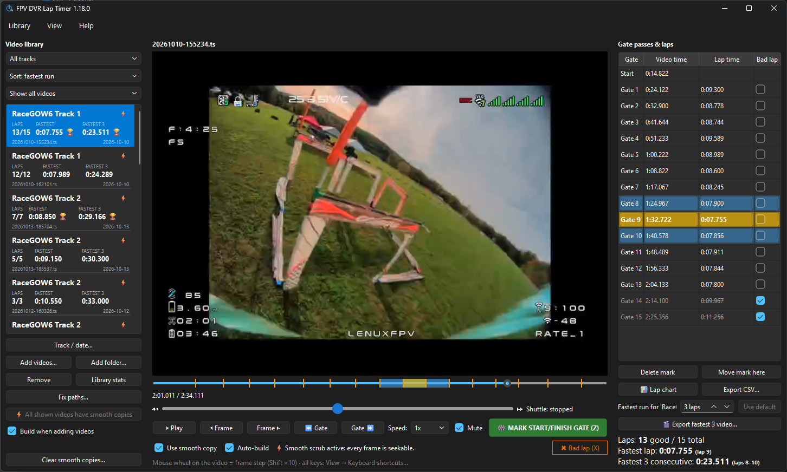

# FPV DVR Lap Timer

Version 1.10.9 (shown in the window title and **Help → About**).

**Download (Windows):** [FPVDVRLapTimer-Setup.exe](https://github.com/lenuxfpv/fpv-dvr-lap-timer/releases/latest/download/FPVDVRLapTimer-Setup.exe)
(installer) · [FPVDVRLapTimer.exe](https://github.com/lenuxfpv/fpv-dvr-lap-timer/releases/latest/download/FPVDVRLapTimer.exe)
(portable) · [all releases](https://github.com/lenuxfpv/fpv-dvr-lap-timer/releases). Linux: see [Install](#install).



**Why I made it:** I was looking for an easy way to review my DVR files to find my laps for competing in
RaceGOW. The app never modifies the DVR video files, and it can export a video of my fastest laps that I can
submit as my RaceGOW entry.

## What it is

FPV DVR Lap Timer turns the footage your goggles record into lap times. Open a flight, step to the exact frame
where you cross the start/finish gate and press one key; every mark after the first ends a lap and starts the
next. There is no timing hardware and no transponder: the video is the stopwatch, and because each mark is
placed on a frame you can see, the times are accurate to the frame and easy to double-check.

## What it can do

- **Mark laps frame by frame.** Play, shuttle (0.1x to 16x), step single frames or jump between gates, then mark
  the frame on screen. Marks can be moved or deleted, and any lap can be flagged as bad.
- **Scrub smoothly.** It builds a small all-keyframe copy of each video in the background, so scrubbing and
  frame-stepping are fluid even on `.ts` DVR files.
- **Keep a library.** Videos are grouped by track and session date, and each card shows the lap count, fastest lap
  and fastest run at a glance. Move or rename files and the marks stay attached.
- **Find your best.** Fastest lap and your fastest run of consecutive laps (3 by default, 2-10 per track), per
  video and across a whole track, with a lap chart and a progress chart to see improvement over time.
- **Export a shareable video.** Cut your fastest run from the original footage with a lap timer drawn on it,
  optional start and end pictures (your pilot handle, say), your own audio or none, and padding either side.
- **Export your data.** Lap times to CSV, and the whole library to a single file you can back up, move to another
  computer or merge into another library.
- **Everything in one place.** Everything the app stores is in one small database and a cache folder (see *Where your data
  lives*).

It runs on Windows (installer or portable exe) and Linux, and reads `.ts`, `.mp4`, `.mov`, `.mkv`, `.m4v` and
`.avi` files. Found a bug or have an idea? [Open an issue](https://github.com/lenuxfpv/fpv-dvr-lap-timer/issues).

## Install

| You use | Easiest route |
|---|---|
| Windows | Download **`FPVDVRLapTimer-Setup.exe`** from the [Releases page](https://github.com/lenuxfpv/fpv-dvr-lap-timer/releases). No Python needed. |
| Linux | Run `./install.sh` from the project folder (needs Python 3.9+). |
| Either, from source | `python3 lap_timer.py` with Python 3.9+ and PyQt6 installed. |

The one thing worth adding yourself is **ffmpeg**; see *What it needs* just below.

### What it needs

- **Python 3.9+ and PyQt6**, only when running from source. The Windows installer and exe bundle both.
- **ffmpeg** (strongly recommended). It provides two programs, and the app works without them, just less smoothly:
  - `ffprobe` reads each video's frame rate. Without it the app assumes 30 fps, and frame-stepping is off for other
    frame rates.
  - `ffmpeg` builds the smooth-scrub copies. Without it scrubbing only jumps between keyframes (see *Navigating the
    video*).
- **The libx264 encoder** inside your ffmpeg, used for the smooth copies and the video export. Debian/Ubuntu's
  `ffmpeg` and the Windows `winget install Gyan.FFmpeg` build include it. Fedora's default `ffmpeg-free` does not:
  enable RPM Fusion and run `sudo dnf swap ffmpeg-free ffmpeg --allowerasing`.
- **A bold font file** for the video export's timer, normally already installed (DejaVu Sans or Liberation on Linux,
  Arial on Windows).

The install scripts check all of this and tell you how to fix anything missing.

### Run from source

```
python3 lap_timer.py                          # open the app
python3 lap_timer.py flight1.ts flight2.mp4   # open and add these videos to the library
```

You can also drag video files or folders onto the window.

### Windows

**Installer (easiest).** Run **`FPVDVRLapTimer-Setup.exe`** (download it from the link at the top). It needs no Python
and no admin rights.

- It installs to `%LOCALAPPDATA%\Programs\FPV DVR Lap Timer`, adds a Start Menu shortcut (and a Desktop one if you
  tick it) and an "FPV DVR Lap Timer" entry in Settings > Apps, where you can uninstall it.
- The uninstaller asks whether to also delete the smooth-scrub copies; your library and videos are never touched.
- The release also has the bare `FPVDVRLapTimer.exe` if you prefer a portable copy (it has no Apps entry).

**"Windows protected your PC" (SmartScreen).** The installer and exe aren't code-signed (a signing certificate costs
money every year), so Windows SmartScreen may show a blue warning the first time you run them. It appears for any
new, unsigned program and doesn't mean anything is wrong with the file. Click **More info**, then **Run anyway**.
If your browser blocks the download, choose **Keep** from its download menu. The source is all in this repository
if you want to check what you are running.

**ffmpeg.** It isn't bundled. If ffmpeg or ffprobe can't be found when the app starts, it offers to install ffmpeg with
winget (tick *Don't ask again* to stop the prompt, and use **Help → Install ffmpeg…** any time). The app picks up a
freshly installed ffmpeg without a restart. You can also install it yourself (`winget install Gyan.FFmpeg`) or put
`ffmpeg.exe` and `ffprobe.exe` in a `bin` folder next to the app.

**Running from source with `install.bat`.** Double-click **`install.bat`** (or run `install.bat -Desktop` for a Desktop
shortcut too). It creates a private `.venv`, installs PyQt6, and adds a Start Menu shortcut and an "FPV DVR Lap Timer"
entry in Settings > Apps that runs the uninstall. It needs Python 3.9+; if Python or ffmpeg is missing it offers to
install them with winget (or run `winget install Python.Python.3.12` yourself), and it warns if your ffmpeg lacks
libx264. If a script fails, the error message says which step; the app itself needs only `pip install PyQt6`.

- `install.bat -Uninstall` removes the shortcuts and leaves your library alone. It asks whether to also delete the
  cached smooth copies to free disk space.
- `install.bat -Uninstall -ClearCache` deletes them without asking.

**Building it yourself.** See [docs/BUILDING.md](docs/BUILDING.md).

### Linux

```
./install.sh               # menu launcher; uses system PyQt6, or creates a private .venv
./install.sh --desktop     # also a Desktop shortcut
./install.sh --uninstall   # remove launcher + icon (library and videos untouched); asks about the smooth copies
./install.sh --uninstall --clear-cache   # ...and delete the smooth copies without asking
```

The script adds an application-menu launcher that points at the folder you run it from, so keep the project folder
where it is after installing (if you move it, run the script again). If anything from *What it needs* is missing, it
warns you and prints the fix for your distro. Uninstalling leaves your library alone and asks whether to also delete
the cached smooth copies to free disk space.

## Where your data lives

Everything is stored in one SQLite database, `library.db`: Linux `~/.local/share/fpv-dvr-lap-timer/`, Windows
`%APPDATA%\fpv-dvr-lap-timer\`. Set the environment variable `FPV_LAP_TIMER_DB` to use a different file. It holds
each video's path, gate marks, bad-lap flags, track name and session date. Back up that one file to keep your
history.

- **Smooth-scrub copies** live in a cache folder, never next to your videos: Linux `~/.cache/fpv-dvr-lap-timer/smooth`,
  Windows `%LOCALAPPDATA%\fpv-dvr-lap-timer\smooth`.
- **Preferences** (theme, keyboard shortcuts, the *Auto-build* / *Build when adding* checkboxes) are stored
  separately by Qt (Linux `~/.config/fpv-dvr-lap-timer/app.conf`, Windows registry) and are not part of the library
  file.
- **Help → About** shows the library folder and the smooth-copies folder as links that open them in your file
  manager.
- **Nothing is written next to your videos** (apart from an exported video, which you choose to save), and the app
  never modifies or deletes video files.

**Duplicate protection.** Adding a file that is already in the library (the same file reached through a
different path, a symlink, or a copy with the same name, size and date) is refused with a warning
listing what was skipped, because the same laps would otherwise be counted twice in your stats. If
duplicates are already in the library they show as **⚠ duplicate** (orange) in the list, and the
Library stats window shows a warning for the track/view that contains them. Remove the extra entry
with *Remove*; the video file and the shared smooth copy are not touched.

If a video is moved or renamed it shows in red; double-click it and pick the new location. Your
marks stay attached.

### Backing up, moving and merging the library

The **Library** menu works on the whole database, so you don't have to find `library.db` yourself:

- **Export library…** saves a copy to a `.db` file you choose (named with today's date by default).
- **Import library (replace)…** swaps your library for an exported file. Your current library is saved
  first as `library-before-import-<date-time>.db` next to `library.db`.
- **Merge library…** adds another library to yours without overwriting anything. Videos are matched by
  file path: new videos come across with their marks, track and session date; for videos you both have,
  marks at times you don't already have are added and an empty track or session date is filled in
  (your own marks and settings are kept). A summary shows what was added.

To move to another computer, export on the old one and import (or merge) on the new one. You can also copy
`library.db` to the new machine's location above.

Video paths are stored as full paths, so they show in red if the videos live somewhere else on the new machine.
Click **Fix paths…** in the library panel:

- It lists every folder that has missing videos, one row each. Pick the new folder for each (they can be different
  places, and a blank row is skipped) and the videos are re-pointed at once.
- It converts between Windows (`D:\Drone`) and Linux (`/mnt/Drone`) style paths.
- It shows how many of the new locations actually exist before you apply it.

## The video library list

Each video in the left panel is shown as a card:

```
RaceGOW6 Track 1                  ⚡
LAPS      FASTEST     FASTEST 3
6/7       0:25.737    1:22.591
20261010-155234.ts       2026-10-10
```

- **Track name** in large bold type (*No track* in grey italics if none is set).
- **LAPS** = good / total laps marked, **FASTEST** = best good lap, **FASTEST 3** = best three good laps in a
  row (a dash until there are three in a row; the 3 follows your *Fastest run* setting for the track, see *Reports*).
  Bad laps are excluded, as everywhere else.
- The **file name** is on a small line at the bottom (shortened in the middle if long), with the session
  date at its right.
- Badges at the top right: **🔒** auto-build is off for this video, **⚡** smooth-scrub copy ready, **⚠ duplicate** (orange) same file listed twice,
  **⚠ not found** (red) the file is missing - double-click it to locate it.
- Hover a card for its full path.

## Workflow

1. **Add videos** with *Add videos…*, *Add folder…* (scans subfolders), or drag and drop. A list of the files found
   is shown first: untick the ones you don't want (or use *Select none* / *Select all*) and pick a **track** for each
   file in the *Track* column. To set many at once, pick a track in the *Track* box under the list and press *Set track
   for ticked files*; *＋ New track…* creates one that doesn't exist yet. The track starts as the one you are viewing.
   Then click *Add N videos*. Files already in the library are greyed out and not added again. Dropping loose files
   adds them straight away, to the track being viewed.
2. Select videos and click **Track / date…** to set a track name and session date (see below).
3. Double-click a video to open it.
4. Play or scrub to the moment you pass through the gate and press **Z** (or the green button; the key can be
   changed, see *Changing the keys*). The first mark starts lap 1; every later mark ends a lap and starts the next.
5. Review the table on the right and flag any bad laps.

### Navigating the video

**Smooth-scrub copy.** FPV recordings (especially `.ts`) have a keyframe only every second or two, and
a player can only show those frames when you jump around, so scrubbing looks stuck and
single-frame stepping doesn't work. The app fixes this by building a small 480p copy of each video in
which every frame is a keyframe (ffmpeg; builds at roughly 5x real time). Each copy takes about
17-19% of the original's size, i.e. 0.5 MB per second of 60 fps footage and 0.8 MB per second at 90 fps
(a 2.5 minute video is ~100-130 MB). Any ffmpeg version works; 5.1+ is preferred and older ones are
handled automatically.
It is built in the background, after which the app switches to it automatically and keeps your
position. When copies get built:

- **When you add videos** (checkbox *Build when adding videos* in the library panel, on by default):
  every new video is queued and built one after another, so a whole folder is ready by the time you
  start reviewing. Videos you already have are not rebuilt.
- **Build smooth copies (N)** button: queues every video in the current list (it respects the track
  filter) that doesn't have a copy yet. While anything is building it becomes **Cancel all builds**,
  and a line under it shows the current video, its percentage and how many are waiting.
- **When you open a video** (*Auto-build* under the player): a video you open that has no copy jumps to
  the front of the queue.
- A **⚡** badge on a video's card in the library list means its smooth copy is ready. Opening a video
  while its copy is still building works fine; it switches over when it finishes.

Once a copy is in use, scrubbing, stepping and reverse are fluid and frame-exact. Marks are saved as
times, so they are identical whichever version you used. More about the copies:

- The copies live in a cache folder (see *Where your data lives*). **Clear smooth copies…** deletes them to free
  space; they can be rebuilt. *Remove* also deletes that video's copy, unless another entry for the same file still
  uses it.
- A copy is found again by the video's **file name, size and modified date**, not its folder, so
  moving or reorganising your videos (or using *Fix paths…*) does not trigger a rebuild. It is rebuilt
  only if the file itself changes or you clear the cache. Two different videos with the same name,
  size and date would share a copy, which in practice does not happen.
- Untick *Use smooth copy* to go back to the original at any time.
- **Right-click** a video in the library to **Delete smooth copy** (just that video's copy, once you have finished
  marking it) and to tick **🔒 Don't auto-build smooth copy**. A locked video is skipped by *Build when adding*,
  *Auto-build* and *Build smooth copies (N)*, and shows a 🔒 on its card. The *Build smooth-scrub copy* button under
  the player still builds it when you ask directly. Both work on a multi-selection, and the lock is saved in the
  library.
- Without ffmpeg (or before the copy is ready) the original is used and the picture can only move
  between keyframes. Marks always use the time of the frame **actually on screen**.

**Slow to fast.** The *Controls* table below lists every key (all can be changed). The main ideas:

- **Shuttle slider** (under the seek bar): drag right to play forward from 0.1x up to 16x, drag left to go
  backward; the further you drag, the faster. Let go and it springs back and stops. This is the quickest way to
  cruise along a lap and then slow down at the gate.
- **Frame stepping** with the arrow keys, the Frame buttons, or the mouse wheel over the video.
- **Seek bar:** click or drag anywhere; orange ticks show where your gate marks are.
- **Gate buttons** jump to the previous / next gate mark.

### Controls

These are the defaults; every one can be changed (see *Changing the keys* below).

| Key | Action |
|---|---|
| Space | Play / pause (also stops a shuttle) |
| Z | Mark start/finish gate pass on the frame shown |
| ← / → | Step one frame back / forward (hold to repeat) |
| Mouse wheel on video | Step frames (Shift = 10) |
| Hold Shift + ← / → | Play backward / forward at 2x while held; stops on release |
| Ctrl + ← / → | Jump 5 seconds |
| J / K / L | Shuttle backward / stop / forward (repeat to speed up) |
| PgUp / PgDn | Previous / next gate mark |
| `[` / `]` | Slower / faster playback (0.1x - 8x) |
| Delete | Delete the selected mark (when the table has focus) |

Audio is muted by default (checkbox under the video).

### Changing the keys

Every key in the table above can be changed: choose **View → Keyboard shortcuts…**, click the box next to an
action and press the key you want (a single key, optionally with Ctrl / Shift / Alt, e.g. `Ctrl+G`). *Default*
puts one action back, *Clear* leaves it without a key, and *Reset all to defaults* restores everything.
Giving two actions the same key (or using Return, which always opens the selected video in the library) is
blocked: the clashing rows turn orange and *Save* stays disabled until you fix it. The choices are
remembered, and the **MARK START/FINISH GATE** button label shows your key for that action. (The line under the
video just points back to this dialog.)

### Dark mode

**View → Theme** offers *Follow system*, *Light* and *Dark*. The choice is remembered. Charts and
dialogs follow the theme too.

### Marks and laps table

- Each row is a gate pass. The lap time on a row is the time since the previous mark.
- Click a row to jump the video to that mark.
- Tick **Bad lap** to exclude that lap (the lap *ending* at that mark). Bad laps are greyed out,
  never counted as a fastest lap, and **break a run of laps**, so "fastest N consecutive" (3 by default) is always N
  good laps in a row. A run never spans two videos.
- **Delete mark** removes a mark (the two neighbouring laps merge).
- **Move mark here** moves the selected mark to the current video position, for fixing a mark that
  was placed slightly off.

## Tracks and session dates

- **Track** groups videos from the same course. It is an editable dropdown: pick an existing track
  or type a new name.
- **Session date** controls ordering in the library list and charts. Choose *Use file date* (the
  file's modified date), *Set date* (manual), or *Keep as is*. Set it manually for copied or
  re-saved files whose file date is wrong.
- **Right-click** a video in the library for the quickest way: **Assign to track** lists your existing
  tracks (ticked if the selected videos are already on it) plus **New track…**; **Remove from track**
  clears it; **Track & session date…** opens the full dialog. It works on a multi-selection, and
  right-clicking an unselected video acts on just that one.
- Select several videos (Shift/Ctrl-click) to tag them all at once. Fields that differ between the
  selected videos are left alone unless you change them.
- The dropdown above the library list filters it by track. Videos you add while a track is selected
  join that track.
- **New empty track:** choose **＋ New track…** at the bottom of that dropdown, type a name, and the app
  switches to the new (empty) track. Videos you add next (*Add videos…*, *Add folder…* or drag and drop)
  join it. The empty track is remembered in the library (it is included in exports, imports and merges) and
  also shows up under *Assign to track*. Typing a name that already exists just switches to that track.
- **Rename or delete a track:** with a track selected, the same dropdown also offers **✎ Rename this
  track…** and **🗑 Delete this track…**. Renaming changes the name on all its videos (typing the name of
  another existing track offers to merge the two). Deleting asks first; the videos stay in the library with
  their marks and simply have no track. Works on empty tracks too, so a typo is easy to fix.

## Reports

- **Per video** (right panel): good / total laps, fastest lap, fastest N consecutive laps.
- **Lap chart** (right panel): bar chart of one video's laps. Green = fastest, grey = bad, dashed blue
  box = fastest N consecutive. Hover a bar for details.
- **Library stats** (left panel): pick a track (or *All tracks*) to see its fastest lap and fastest N,
  a per-video table, and a **By track** table comparing every track.
- **Progress chart** (in Library stats): one point per video in session-date order, showing fastest lap
  and best-N average per lap for the selected track, to see improvement over time.
- **Export CSV**: from the right panel (current video) or Library stats (selected track). Columns:
  `track, session_date, video, lap, start_s, end_s, lap_time_s, lap_time, bad_lap`. Bad laps are
  included and marked `yes`, so you can filter them in a spreadsheet.

**Choosing N.** The *Fastest run for 'track':* box in the right panel sets how many consecutive laps count as the
fastest run, from 2 to 10, **per track**. It applies to the track of the open video (or the track picked in the
library filter); *Use default* removes a track's own setting. Tracks without one use the **default of 3**, which
can't be changed (the box is greyed out when there is no track). Everything follows it: the library cards, the
per-video and library stats, the lap chart, the progress chart and the export. It is saved in the library, so it
travels with exports and merges and follows a track when you rename it, and changing it never alters your marks.
A video shows a dash when it doesn't have N good laps in a row.

In **Library stats**, each row shows the run length used (*Run (laps)*). With *All tracks* selected and tracks using
different lengths there is no single "fastest N" headline, so the tables show each track's own figure, and the video
export asks you to pick one track first.

### Export the fastest N laps as a video

Makes a shareable video of your fastest N consecutive laps (N = the track's *Fastest run* setting, 3 by default)
with a lap timer drawn on it.

- **From the open video:** **🎬 Export fastest N video…** in the right panel exports that video's fastest
  N consecutive laps. **From a track:** **Library stats → 🎬 Export fastest N video (this track)…** exports
  the single fastest run of N laps across all videos on the selected track (or *All tracks*), whichever video they
  are in. The *Save as* box starts in the same folder as the source video (or your Videos folder if that
  folder can't be found); change the name or folder if you like, then click *Export*. A progress bar shows how far
  it is, and *Cancel* removes the partial file. When it finishes, an *Open the folder* link opens the folder.
- **What you get:** an MP4 (H.264) of the **original footage**, not the smooth copy, at its original
  resolution and frame rate (a 90 fps video stays 90 fps), cut on the exact frames you marked, with
  1 s before the first gate and 2 s after the last one by default (change them with "Start padding" and
  "End padding" in the export dialog, 0–10 s each; **Reset padding** puts both back to the defaults; your
  choice is remembered; the start can't go earlier than the start of the video). It is re-encoded at high quality
  (x264 CRF 16, slow preset) with BT.709 colours so it plays correctly on YouTube, Discord and phones.
  Audio is kept if the source has any, unless you tick **Remove audio** in the export dialog (remembered) or
  choose **Replace audio with:** an audio file of your own (mp3, wav, m4a, flac, ogg…; or any file that has an audio
  track). The replacement starts with the clip, is padded with silence if it is shorter and fades out over the last
  second if it is longer. The two options are alternatives: choosing a file switches *Remove audio* off. The
  audio file you used last is remembered (if it is still there) and filled in next time; *Clear* forgets it.
- **Start and end pictures (stickers):** choose a **Start picture:** and/or an **End picture:** (they can be
  different files; a PNG with transparency works best, JPG, WebP, BMP and GIF also work), for example your
  pilot-handle sticker. Each is placed in the centre of the video. The start picture is shown from the first
  frame and fades out over the last half second of its time; the end picture fades in over the first half second
  of its time and stays to the end. *Shown for* sets how long (0.5-10 s) and *Size* the picture's height as a
  percentage of the video height (never enlarged past its own size). They sit over the first / last seconds of
  the clip, so raise *Start padding* or *End padding* to show them over footage before the first gate or after
  the last lap. The pictures and their settings are remembered.
- **The overlay:** top left, the current lap number and a running lap timer that restarts at each gate,
  with each finished lap's time listed underneath; top right, the track name and date and the running
  total of the N laps; after the last gate the final lap and total are held on screen and a gold
  *FASTEST N CONSECUTIVE LAPS m:ss.mmm* banner appears. Times show as `ss.mmm` until they reach a minute, then
  `m:ss.mmm`.
- **Requirements:** the export needs ffmpeg with libx264 and the `drawtext` filter (built with freetype; every normal
  full build has it), and a bold font file (see *What it needs*). The app checks all of this before exporting and
  tells you in plain words what to fix. The source video must be reachable (a network share that is offline shows
  an error).
- **Speed:** exporting is slow because it is a high-quality re-encode: about 30 s for a 28 s 60 fps clip on a fast
  machine, and a few minutes for a 90 fps clip read from a network share, so leave it running.
- **YouTube** plays up to 60 fps, so a 90 fps export is shown at 60 there; the file itself is left untouched.

## Notes

- If something unexpected goes wrong the app shows a message in the status bar and keeps running
  instead of closing; the details are written to `errors.log` next to the library database.
- *Remove* only deletes the video from the library (and its marks); the video file is untouched.
- Playback of `.ts` files uses Qt's ffmpeg backend. If a file won't play, check the status bar for
  the player error.

## License

MIT, see [LICENSE](LICENSE). The Windows exe and installer bundle [PyQt6](https://www.riverbankcomputing.com/software/pyqt/),
which is licensed under the GPL v3.
