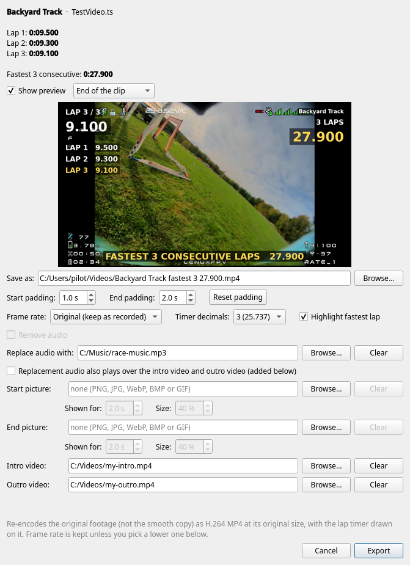

# How to export your fastest laps as a video

The export turns your fastest run of N consecutive laps into a shareable MP4 with a live lap timer drawn on it.
This page walks through every option in the export window.

## Opening the export window

- **One video:** open the video, then click **🎬 Export fastest N video…** in the right panel. It exports that
  video's fastest N consecutive laps.
- **A whole track:** in the library stats, click **🎬 Export fastest N video (this track)…**. It finds the single
  fastest run of N laps across every video on the selected track (or *All tracks*), whichever video it is in.

- **Any laps you choose:** with a video open, click **Export laps…** in the right panel. Pick the first and
  last lap (the same number twice exports one lap) and the same export window opens for them. It starts on the lap
  at the playhead, shows the total time, and tells you if a flagged-bad lap is inside the range (it is still
  included). The video's own lap numbers are drawn on the overlay (*LAP 5 / 9*, *LAPS 3-5*), and the file is named
  after the laps (`Backyard Track laps 3-5 25.900.mp4`).

N is the track's *Fastest run* setting (3 by default).

The top of the window lists the track, the source video, each lap time and the combined time of the run.

## Top to bottom

The window is split into four groups, under the preview.

### Show preview
Tick **Show preview** to draw one frame of the finished video, using exactly the same filters as the real export,
so what you see is what you get. Pick which moment to look at: **End of the clip**, **During the last lap** or
**Start of the clip**. The preview redraws a moment after each change. Turn it off if it slows the window down
(your choice is remembered). The preview shows the lap clip only, not the intro or outro videos.

## Output

- **Save as:** where the MP4 is written. It starts in the same folder as the source video, named after the track, the
  lap count and the total time. Change it or use **Browse…**. If the file already exists you are asked before it is
  replaced.
- **Start padding / End padding:** extra footage kept before the first gate (default 1 s) and after the last gate
  (default 2 s), 0 to 10 s each. During the start padding the timer waits at 0.000; during the end padding the final
  total stays on screen. If you ask for more than the video has, you simply get what is there. **Reset padding**
  restores the defaults.
- **Frame rate:** **Original** keeps the recorded rate (a 90 fps video stays 90 fps). **60 fps** or **30 fps** lowers
  it, which is handy for YouTube, which plays at most 60 fps. A video already at or below your choice is left alone.
  The timer is drawn before the rate is lowered, so it stays exact.

## Timer

Make room for your DVR's own on-screen display, and choose how the timer looks:

- **Text size:** *Small*, *Medium* (the default) or *Large*.
- **Decimals:** how many digits follow the seconds on the timer: `3 (25.737)`, `2`, `1` or `0`.
- **Swap sides:** puts the lap timer on the right and the total and track name on the left.
- **Show:** untick **Lap list** (the finished laps under the lap timer), **Track name**, **Total** (the running total)
  or **Banner** (the gold banner at the end) to leave them out.
- **Highlight fastest lap:** shows the fastest of the exported laps in gold in the finished-laps list.

The preview updates as you change them, and your choices are remembered. For a single chosen lap the total and the
lap list are left out automatically, since the lap timer already shows the same time.

## Pictures

Add a picture, such as your pilot-handle sticker, in the centre of the video. PNG with transparency works best;
JPG, WebP, BMP and GIF also work.

- **Start picture** shows from the first frame and fades out after the time you set.
- **End picture** fades in and stays for the last part of the clip.
- **Shown for** (0.5 to 10 s) and **Size** (picture height as a percentage of the video height, never enlarged past its
  own size) appear once you have chosen a picture.

## Intro, outro and audio

- **Intro video / Outro video:** add a video of your own before and/or after the lap clip, for example a channel intro or
  a "thanks for watching". Pick any video file with **Browse…**; **Clear** removes it. Your choice is remembered.
  Each is fitted inside the same frame size as the lap clip (with black bars if the shape differs) and brought to the
  same frame rate and colours, so everything joins cleanly into one file. The lap timer and pictures appear only on
  the lap clip, and the intro and outro are re-encoded with the rest, so they add to the export time.
- **Remove audio (whole video, including intro and outro)** exports with no sound track at all: the lap clip, the
  intro and the outro are all silent. Otherwise the video's own sound is kept (if it has any).
- **Replace audio with:** picks your own audio file (mp3, wav, m4a, flac, ogg… or any file with an audio track). It
  starts with the clip, is padded with silence if shorter and fades out over the last second if longer.
  *Remove audio* and *Replace audio with:* are alternatives: choosing a file switches *Remove audio* off. Your last
  audio file is remembered while it still exists; **Clear** forgets it.
- **Replacement audio also plays over the intro video and outro video:** only available when you have chosen a
  replacement audio file **and** an intro or outro video. Unticked (the default), your audio covers the lap clip only
  and the intro and outro keep their own sound (or silence if they have none). Ticked, your audio plays under the
  whole video and fades out at the very end; the intro and outro's own sound is dropped.

## Exporting

Click **Export**. A progress bar shows how far along it is. High quality takes a while, a few minutes for a
typical 25-30 s clip and longer at 90 fps. **Cancel** stops the job and removes the partial file. When it
finishes, **Open the folder** takes you to the video.

The result is an H.264 MP4 of the **original footage** (not the smooth copy) at its original resolution, cut on
the exact frames you marked, with BT.709 colours so it plays correctly on YouTube, Discord and phones.

Each exported file carries a small tag saying it came from this app. That is how the DVR folder check and *Add folder…* know
to leave your exports out of the library, even if you rename them.

## Requirements

Export needs a full **ffmpeg** build with the libx264 encoder and the drawtext filter (the app offers to install
it from **Help → Install ffmpeg…**), and a bold font file for the timer. If something is missing the window tells
you what to install.
